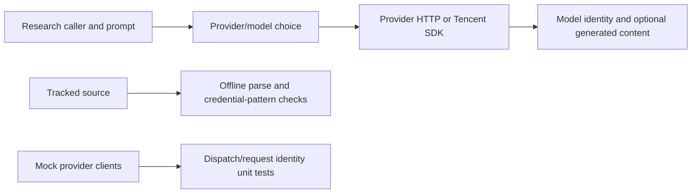

# Design and limitations

## Separation of entry points

`alphas2/` and `alphas_zero/` contain historical research/miner scripts, not one packaged application or stable hosted API. `alphas2/call_api.py` is an importable provider mixin; callers supply the surrounding researcher behavior. Its import does not make provider requests. Other entry points can authenticate or perform work at import time; there is no universal startup/stop contract.

The 0.0.3 fix uses the selected Hunyuan model in the request and returns that identity, instead of always requesting t1 while reporting a random choice. A mock SDK test forces the alternate model and checks both payload identity and response content. It establishes local request construction, not model existence or remote success.

## Configuration, outputs and failures

Provider variables and Python versions are listed in [README](README.md). HTTP methods use bounded request timeouts (80 seconds) and retry loops with sleeps. `max_retries` is a loop count; callers should supply a positive integer. Exceptions and non-200 responses may be logged; inspect/sanitize local logs before sharing them because provider responses can contain sensitive request/context data. This release does not add response redaction or universal validation of every retry argument.

The normal output is `(model_name, content_or_none)`. Model selection/randomness, provider availability and generated expression validity are independent. Returned text must be checked separately before simulation. No deterministic seed, semantic parser, native acceptance or profitability contract is provided by the mixin.

Retries can repeat billable provider calls after ambiguous failures; these scripts do not inherit brain_work's no-replay ownership discipline. They must not be treated as a protected submission or trading gateway. Recovery requires understanding the exact script and external request state; restarting an arbitrary miner is not a documented safe reconciliation operation.

## Development, provenance and release

The hosted workflow runs source parsing/credential-pattern checks, local-doc link checks and the full unittest suite on Python 3.11/3.12/3.13. Validation uses mocks and no third-party runtime dependencies. Runtime packages for the research scripts are separate and script-specific; the offline CI is not a pinned deployment environment. Learned/provider-generated content and downloaded files are not independently verified data products.

Version is declared by `VERSION`; [RELEASE_REVIEW.md](RELEASE_REVIEW.md) retains the dated local patch evidence. Source tests do not validate paid APIs, external SDK behavior, historical strategy claims or native submissions. There is no CD pipeline. Keep unrelated notebooks/data/credentials out of publication and compare the reviewed release tree with the exact remote base before publishing.
